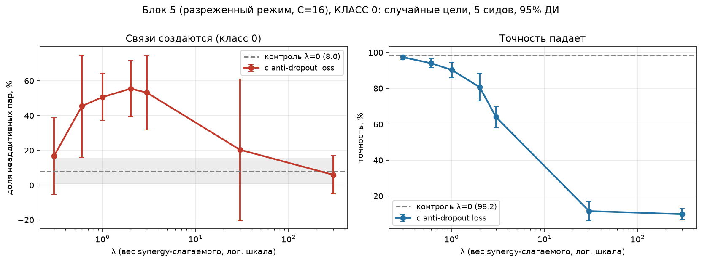
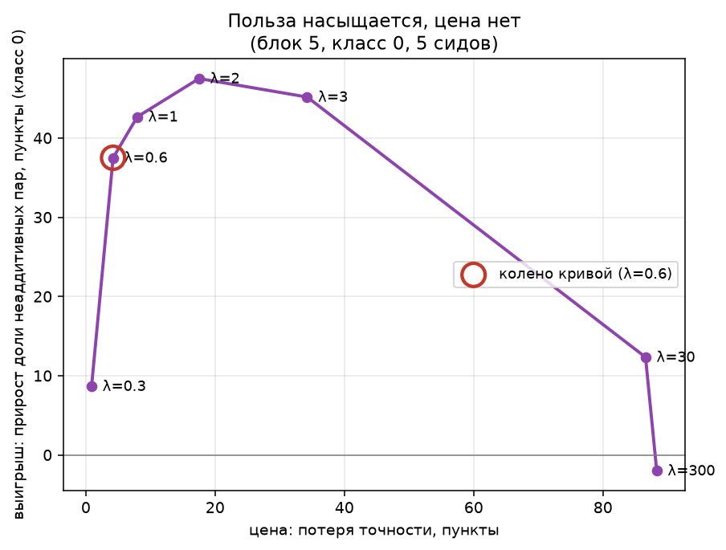
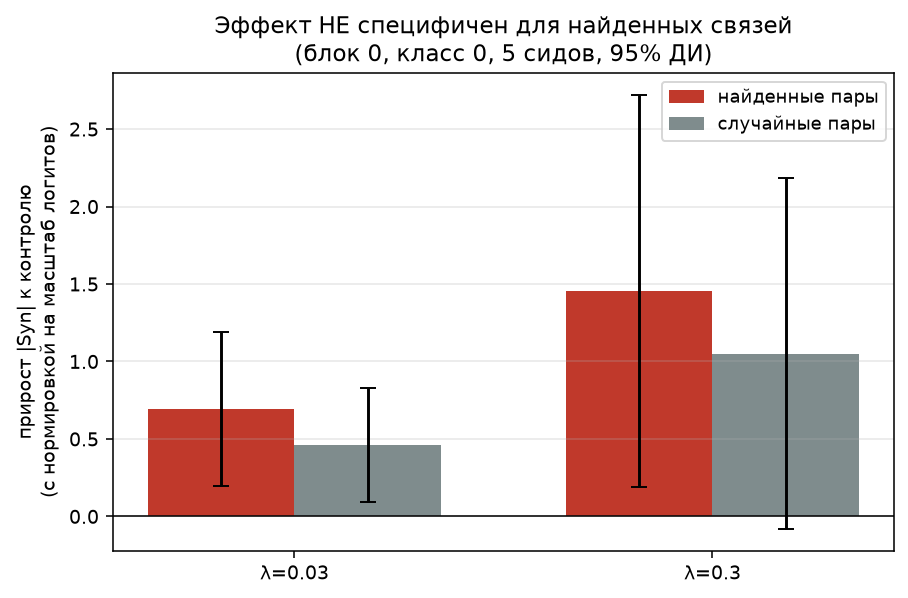
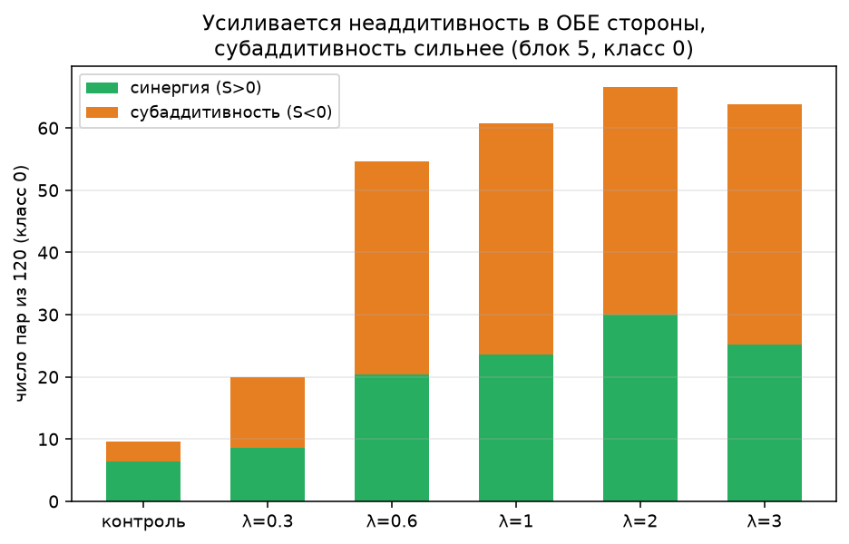
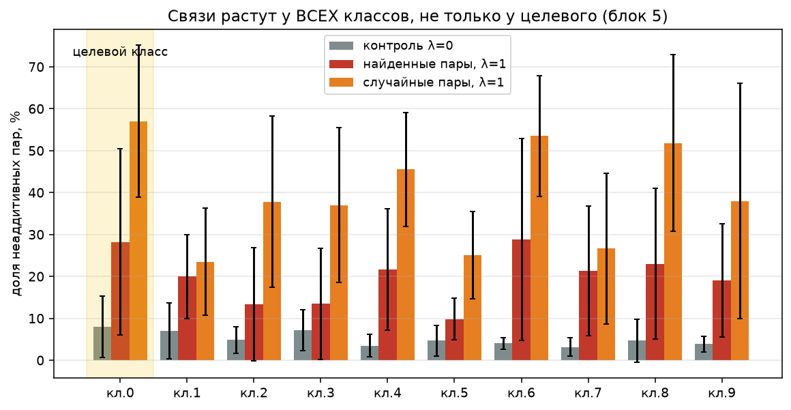

# Anti-dropout loss: можно ли управлять попарными связями между каналами


## Коротко

1. **Связи можно создать там, где их почти нет** — доля неаддитивных пар выросла с 8% до 45–55% (во всех 5 сидах, p≤0.01), причём **у всех 10 классов**, а не только у того, к которому привязано вмешательство.
2. **Но не бесплатно.** Бесплатной точки в разреженном режиме нет; минимальная цена значимого прироста — 4.2 пункта точности.
3. **Польза насыщается, цена нет.** Выигрыш выходит на плато при λ=0.6, а цена дальше растёт в 8 раз.
4. **Эффект не избирателен** — случайные пары со случайными знаками работают не хуже найденных.
5. **Эффект выходит за пределы целей**: затронуто больше пар, чем было целей.
6. **Усиливается неаддитивность в обе стороны**, причём субаддитивность сильнее синергии.
7. **Цена — потеря ёмкости, а не обобщения**: растёт и обучающий CE, то есть сеть хуже подгоняется под сами обучающие данные.
8. **Это не регуляризация.** Разрыв между тестовой и обучающей ошибкой при наращивании связей не сужается, а расширяется.
9. **Сеть ухудшается равномерно, а не коллапсирует в один класс** — значит точность здесь честная сводка и ничего не скрывает.
10. **Главное следствие:** отсутствие связей в ResNet-18 — не архитектурный запрет. Их туда можно вложить; сеть не создаёт их сама, потому что это конкурирует с задачей.

## Метод

Измеряемая величина — попарная причинная неаддитивность каналов:

```
TE(X)     = логит истинного класса (baseline) − логит после зануления X
Syn(A,B)  = TE(A,B) − TE(A) − TE(B)
```

Вмешательство — слагаемое в функции потерь, толкающее `Syn` в заданную для каждой пары сторону:

```
loss = CE − λ · mean( sign(A,B) · Syn(A,B) )
```

Сеть — TapNet (BatchNorm + residual, то есть BasicBlock ResNet-18 с фиксированной шириной), C=16, 6 блоков, MNIST, обучение с нуля, 3 эпохи, 5 сидов. Сигнал применяется только к примерам класса 0 внутри обычных смешанных батчей; CE обучается на всех 10 классах, поэтому точность в таблицах — точность на полной задаче.

Главная метрика результата — **доля неаддитивных пар у обученной сети** из всех 120 (FDR-BY + порог эффекта). Она не зависит от того, какие пары были целями.

**Оговорка про класс.** Вмешательство привязано к одному классу: `Syn` в лоссе считается по вероятности класса 0 на примерах класса 0. Основная метрика в таблицах тоже считается по классу 0. Отдельно измерена доля неаддитивных пар по **каждому из 10 классов** — см. раздел 5: связи растут у всех классов, у целевого сильнее.

## 1. Связи создаются — в разреженном режиме

Два режима различаются тем, сколько места для роста есть изначально:

| точка отвода | доля неаддитивных пар у контроля | запас роста |
|---|---:|---|
| блок 0 | **92.3%** | 7.7% |
| блок 5 | **8.0%** | 92% |



*Доля неаддитивных пар здесь и далее считается по логиту класса 0 на его примерах — это связи в представлении класса 0, к которому привязано вмешательство.*

| λ | доля неаддитивных | Δ к контролю | p | точность | Δ точности |
|---|---:|---|---:|---:|---|
| 0 (контроль) | 8.0% | | | 0.9822 | |
| 0.3 | 16.7% | +8.7 | 0.203 | 0.9734 | −0.88 (н/з) |
| **0.6** | **45.5%** | **+37.5** | **0.0095** | **0.9401** | **−4.21** |
| 1 | 50.7% | +42.7 | 0.0002 | 0.9027 | −7.95 |
| 2 | 55.5% | +47.5 | 0.0004 | 0.8071 | −17.5 |
| 3 | 53.2% | +45.2 | 0.0036 | 0.6399 | −34.2 |

**Это не просто выросшие логиты.** `Syn` измеряется в единицах логита, поэтому если бы сеть равномерно раздула все логиты вдвое, то и все `TE`, и `Syn` выросли бы вдвое при полностью неизменной структуре — и мы приняли бы это за рост связей. Чтобы исключить такое объяснение, отдельно проверяется масштаб: разброс логита истинного класса по картинкам, `std(baseline_logit)`. Он не изменился — **1.468 у контроля против 1.466 при λ=3**, — тогда как |Syn|, нормированный на этот масштаб, вырос с 0.0072 до 0.0634 (p=0.033). Значит выросло взаимодействие, а не шкала.

## 2. Кривая компромисса: польза насыщается, цена нет



*Выигрыш по оси Y — прирост доли неаддитивных пар класса 0; цена по оси X — потеря общей точности на всех 10 классах.*

Выигрыш выходит на плато 45–55% уже при λ=0.6 и дальше не растёт, а цена на том же участке увеличивается с 4.2 до 34.2 пункта. Эффективность падает монотонно: 8.9 → 5.4 → 2.7 → 1.3 пункта доли на пункт точности. **Колено кривой — λ=0.6.**

Бесплатной точки нет: при λ=0.6 потеря значима (p=0.0075), а единственная точка с незначимой ценой (λ=0.3) даёт и незначимый прирост.

**Цена — потеря ёмкости, а не обобщения.** Обучающий CE при λ=0.6 вырос с 0.068 до 0.187 (p=0.023): сеть хуже подгоняется под сами обучающие данные. Связи и задача конкурируют за одни и те же веса.

## 3. Эффект не избирателен — в насыщенном режиме



*Прирост |Syn| измеряется на парах класса 0.*

Случайные пары со случайными знаками дают прирост, статистически неотличимый от найденных значимых пар: +0.46 против +0.69 при λ=0.03 (разница p=0.35). Цена точности тоже одинакова (−0.44 против −0.29 пункта).

Причина видна из отдельной проверки: разметка на случайной сети почти ничего не говорит об обученной — за 3 эпохи обычного обучения **41% пар меняют знак** `Syn` (случайность — 50%), корреляция начальных и конечных значений около нуля (−0.09…+0.29 по сидам), а сама величина |Syn| растёт примерно в 1000 раз (0.0005 → 0.6).

**Эффект шире целей.** В разреженном режиме при λ=0.6 неаддитивными стали ~55 пар из 120 против ~10 у контроля — прирост 45 пар при том, что целей было всего 30. Значит минимум 15–25 пар, которых никто не трогал, тоже изменились. Лосс действует на слой целиком, а не на заданные пары.

## 4. Усиливается неаддитивность в обе стороны



*Пары класса 0, все 120 из C(16,2).*

Знак каждой пары фиксируется как её собственный, поэтому максимизируется |Syn| — величина неаддитивности в том направлении, которое у пары уже было. У контроля субаддитивных пар треть, под действием лосса — почти две трети.

Для интерпретации это существенно, потому что два типа означают противоположное: синергия — «каналы нужны только вместе» (удалять нельзя ни один), субаддитивность — «дублируют друг друга» (один можно удалять смело). Текущий лосс их смешивает, так как фиксирует знак каждой пары по её собственному. Если понадобится управлять одним типом, слагаемое придётся переписать. Правил прунинга на основе неаддитивности у нас пока нет, и полезна ли она для него — открытый вопрос.

## 5. Связи растут у всех классов, а не только у целевого



*Единственный график, где измерение ведётся по всем 10 классам, а не только по целевому.*

Вмешательство привязано к классу 0, но представление общее, поэтому отдельно измерена доля неаддитивных пар по каждому из 10 классов (блок 5, 5 сидов):

| условие | класс 0 | классы 1–9 (среднее) |
|---|---:|---:|
| контроль | 8% | 4.8% |
| найденные пары, λ=1 | 28% (**+20.2**, p=0.038) | 18.9% (**+14.2**, p=0.022) |
| случайные пары, λ=1 | 57% (**+49.0**, p=0.0003) | 37.6% (**+32.9**, p=0.0023) |

Рост значим и у целевого класса, и у остальных девяти. У класса 0 он примерно **в 1.5 раза сильнее**, но эффект явно не локализован в нём — лосс перестраивает представление слоя целиком.

## 6. Это не регуляризация, а ухудшение по обоим направлениям

Гипотеза была такая: обучающий CE растёт, но если слагаемое работает как регуляризатор, то разрыв между тестовой и обучающей ошибкой должен сужаться. Проверка (блок 5):

| условие | test CE − train CE | Δ к контролю | p |
|---|---:|---|---:|
| контроль | −0.0022 | | |
| найденные, λ=0.6 | +0.0341 | +0.036 | 0.23 |
| случайные, λ=0.6 | +0.0407 | +0.043 | 0.38 |
| найденные, λ=1 | +0.0833 | **+0.086** | **0.028** |
| случайные, λ=1 | +0.1191 | +0.121 | 0.082 |

Разрыв не сужается, а **расширяется**, и при λ=1 это значимо. Наращивание связей ухудшает и подгонку под обучающие данные, и перенос на тестовые. Гипотеза о регуляризации не подтвердилась.

При λ=0.3–0.6 расширение незначимо, так что строго утверждать его можно только для λ=1.

## 7. Ухудшение равномерное, а не вырождение в один класс

| условие | точность | macro-F1 | доля самого частого предсказания |
|---|---:|---:|---:|
| контроль | 0.9822 | 0.9820 | 0.117 |
| найденные, λ=1 | 0.9018 | 0.9008 | 0.129 |
| случайные, λ=1 | 0.8340 | 0.8304 | 0.138 |

Метрики падают все. Macro-F1 повторяет точность до третьего знака, доля самого частого предсказания остаётся около 0.12 при равномерном уровне 0.1, F1 падает у **всех десяти** классов без исключений (от 0.7 до 4.8 пункта при λ=0.3, от 3.3 до 26.4 при λ=1).
Точность можно использовать как основную метрику, она не скрывает вырождения.

## 8. В разреженном режиме случайные цели работают СИЛЬНЕЕ найденных

На блоке 0 найденные и случайные пары неразличимы (раздел 3). На блоке 5 разница появилась — и в пользу случайных:

| λ | Δ доли неаддитивных (найденные − случайные) | p |
|---|---:|---:|
| 0.3 | **−19.0 п.** | 0.028 |
| 0.6 | −15.0 п. | 0.206 |
| 1 | **−28.8 п.** | 0.025 |

Случайные цели создают больше связей. По точности они обходятся дороже (−6.8 пункта при λ=1), но разница незначима (p=0.088).

Правдоподобное объяснение: случайные знаки конфликтуют с тем, что сеть хочет выучить, сильнее, чем измеренные, и именно величина конфликта движет и рост неаддитивности, и цену.

## 9. Что это значит для null-результата по ResNet-18

Исходная находка проекта: в ResNet-18 попарных причинных связей между каналами практически нет — ни на одной глубине, ни при обучении на ImageNet, ни на CIFAR-10. Эти эксперименты уточняют её формулировку.

Связи в глубоких блоках **не архитектурно невозможны** — их туда можно вложить принудительно, и довольно много (с 8% до 55%). Сеть не создаёт их сама не потому, что не может, а потому что это конкурирует с решением задачи: каждый вложенный процент неаддитивности оплачивается точностью и ухудшением подгонки под обучающие данные.

Это первое в проекте **причинное** свидетельство по вопросу «вредны ли связи для качества». До сих пор были только корреляции: ширина слоя и dropout гасят связи и одновременно повышают качество, но направление из этого не следовало.

**Осторожная формулировка.** Показано, что принудительное создание связей стоит точности. Это не доказывает, что связи вредны сами по себе: часть цены может идти от оптимизации по постороннему критерию как таковой — в контроле цена оказалась одинаковой у реальных и случайных целей. Чтобы разделить, нужен контроль с посторонним критерием той же величины, не связанным с синергией.

## Методологическое, что важно при воспроизведении

**BatchNorm** Расчёт синергии делает ~31 дополнительный прямой проход на шаг, и они портят накопленные статистики BN. После заморозки BN на время расчёта остаётся вторая проблема: CE считается по батч-статистикам, а synergy-слагаемое по накопленным, и расхождение между ними ничем не штрафуется. Замер: сеть даёт **0.965** точности на батч-статистиках и **0.134** на накопленных — то есть обучена, но `eval()` этого не видит. Лечится полным пересчётом статистик **на каждом шаге**: раз в 20 шагов разрыв не закрывается (0.73–0.79), каждый шаг — закрывается (0.002–0.006). Цена около 8% времени.

**λ не переносится между конфигурациями.** Рабочее значение на блоке 0 — около 0.03, на блоке 5 — около 0.6, разница в 20 раз.

Причина в том, что одно и то же вмешательство на разной глубине даёт разный по величине эффект. В residual-блоке выход считается как `relu(bn2(conv2(a)) + x_in)`: зануление каналов в `a` меняет только ветвь с `conv2`, а вход блока `x_in` приходит на сумматор в обход неё. В последнем блоке после этого остаются только усреднение и линейная голова, поэтому значительная часть сигнала доходит до классификатора нетронутой. На блоке 0 возмущению предстоит пройти ещё пять блоков, где оно успевает повлиять на всё последующее вычисление. Измеренная разница: средний |Syn| у контроля составляет 0.603 на блоке 0 и 0.0097 на блоке 5, то есть в **62 раза** меньше.

Точку баланса `λ ≈ CE / signal` надо считать заново для каждой конфигурации.

## Ограничения

- Одна точка отвода на эксперимент; вмешательство привязано к классу 0, хотя структура измерена по всем 10 классам (раздел 5).
- Разница «найденные против случайных» на блоке 5 (раздел 8) получена при n=5, с p на границе значимости и в двух λ из трёх: как гипотеза правдоподобна, как установленный факт — нет.
- Три эпохи — на плато выходит только контроль.
- Доля неаддитивных пар при λ=0.3 имеет огромный разброс по сидам: от 3% до 47%.
- C=64 и настоящий ResNet-18 не проверялись.
- Синергия «для всех классов сразу» не проверялась: на смешанных классах разметка даёт 0 значимых пар, так как у одной пары знак разный для разных классов и гасится усреднением.

## В работе — контрольная проверка: падает ли точность от ЛЮБОГО второго слагаемого

**Что проверяем, простыми словами.** Падает ли точность (и остальные метрики) от любого второго слагаемого в функции потерь — или именно от того, что мы наращиваем попарные связи.

**Вопрос формально.** Мы наблюдаем: добавили слагаемое — выросла попарная неаддитивность *и* упала точность. Вызвано ли падение точности **неаддитивностью** или просто тем, что в лоссе появилась вторая, конфликтующая с задачей цель? В первом случае «связи конкурируют с задачей» — содержательное утверждение о сетях; во втором мы измерили лишь то, что оптимизация по двум целям хуже, чем по одной.

**Что считать ответом.** Если канальные группы роняют точность так же, как попарная, не наращивая при этом попарных связей, то цена платится за сам факт второй цели в лоссе, а не за связи.

**Контрольные слагаемые.** Все группы идентичны по всему — сеть, точка отвода, класс, примеры, двойное усреднение, пересчёт BN. Отличается ровно одна вещь в каждой:

```
random_only  term = mean( sign(A,B) · [TE(A,B) − TE(A) − TE(B)] )   эталон, второй порядок
single_real  term = mean( sign(A)   ·  TE(A) )                      первый порядок, значимые каналы
placebo_te   term = mean( sign(A)   ·  TE(A) )                      первый порядок, все каналы, случайные знаки
placebo_act  term = mean( sign(c)   ·  mean(a[:, c]) )              вообще без абляции
```

Три уровня: `single_real` и `placebo_te` убирают попарность, сохраняя причинность; `placebo_act` убирает и причинность, оставляя только «вторая цель в лоссе».

λ не согласовывается между группами: у каждой своя кривая (попарная 0.3–1, канальные 0.03–1), и сравнение идёт при **одинаковой фактической цене точности**.

### Чего ждать от сравнения

Попарное слагаемое создано ради попарных связей, поэтому его преимущество на них ожидаемо и само по себе ничего не доказывает. Интересны два других исхода:

- **канальные группы тоже наращивают попарные связи** — значит это побочный эффект почти любого вмешательства в обучение слоя, а не заслуга прицельного давления;
- **попарное слагаемое проигрывает** какой-то из канальных групп — неожиданная находка, означающая, что прицельность не нужна и метод можно упростить.

### Известные ограничения этого сравнения

1. **`placebo_te` и `single_real` различаются в двух вещах сразу** — отбором каналов (все 16 против 9 значимых) и знаками (случайные против измеренных). Если одна из них выиграет, по результатам нельзя будет сказать, за счёт чего: отбора или знаков. Для разделения нужна была бы ещё группа «значимые каналы со случайными знаками».
2. **Размеры пулов целей разные** — 30 пар, 16 каналов, 9 каналов. Чем меньше пул, тем жёстче давление на каждую цель при той же λ, так что часть разницы между группами может идти отсюда.
3. **Узкие рамки:** один блок (5), один класс (0), 3 эпохи, 5 сидов, MNIST, C=16. На C=64 и на настоящем ResNet-18 не проверялось.
