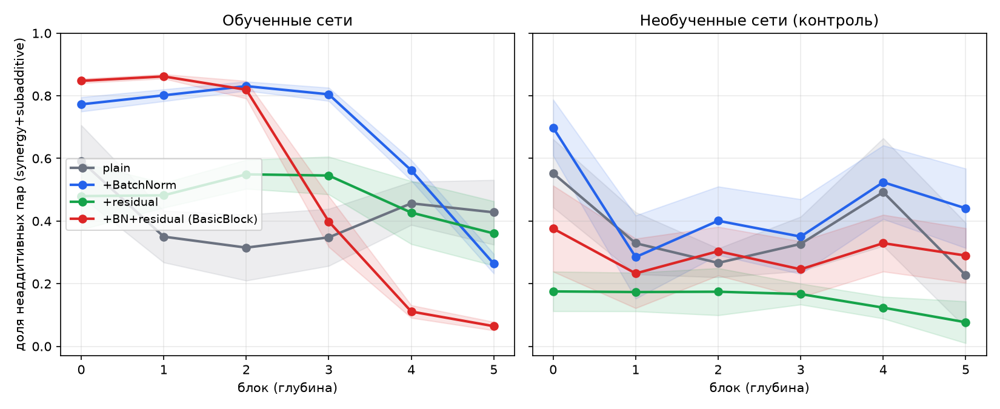
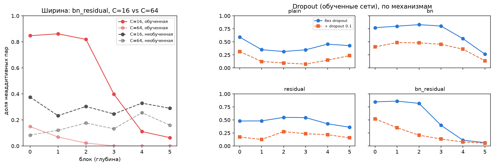

# Профиль по глубине: что из BatchNorm/residual/ширины/dropout гасит попарные связи

## Постановка эксперимента

**Вопрос.** В маленькой сети (conv1+conv2, `synergy_experiments/experiment_common_task.ipynb`) попарные причинные связи между каналами есть. В ResNet-18 — почти нет, на любой проверенной глубине (`synergy_experiments/`, `class_vs_rest_experiments/`). ResNet отличается от маленькой сети сразу в нескольких измерениях — BatchNorm, residual-сложение, ширина слоёв (64-512 вместо 6-64 каналов), обучающая регуляризация. Реальная сеть не может разделить эти факторы — нужна управляемая архитектура.

**Архитектура — TapNet.** Conv-стебель + `DEPTH` одинаковых по ширине `C` блоков + avgpool + fc. Каждый блок:

```
x → conv1 → (BatchNorm?) → ReLU → [точка абляции "a"] → conv2 → (BatchNorm?) → (+identity блока?) → ReLU → следующий блок
```

Точка абляции "a" — прямой аналог pre-conv2 хука в `synergy_experiments/resnet_layer_interactions.py`. Сеть строится **один раз** с фиксированной глубиной (`DEPTH=6`) и обучается целиком, одним проходом Adam. Профиль по глубине получается не повторным обучением разных по глубине сетей, а измерением причинного теста **в каждой из 6 точек внутри одной уже обученной сети**.

**Причинный тест** — тот же протокол, что везде в проекте: $S(A,B)=TE(A)+TE(B)-TE(A,B)$, $TE=\text{baseline}-\text{ablated}$, do(zero channel) как интервенция, FDR-BY поправка + порог эффекта $\tau$. Метрика на графиках — **доля неаддитивных пар** (synergy + subadditive) из всех протестированных, усреднённая по 10 классам MNIST.

**4 варианта механизма** — отдельные, независимо обученные с нуля сети (не "включение/выключение" внутри одного прогона):

| механизм | BatchNorm | residual |
|---|:-:|:-:|
| `plain` | — | — |
| `bn` | ✅ | — |
| `residual` | — | ✅ |
| `bn_residual` (= BasicBlock ResNet-18, фикс. ширина, без downsample) | ✅ | ✅ |

Для каждого — 5 обученных (5 эпох, Adam) + 5 необученных (случайная инициализация + калибровка BatchNorm на обычных изображениях, без обучения) сетей, C=16, полный перебор пар (C(16,2)=120).

**Дополнительно** — ширина (`bn_residual` при C=64, 2+2 сида, 300 случайных пар на блок) и dropout (0.1, channel-wise, действует только при обучении — в `.eval()` это identity, причинный тест всегда в `.eval()`), теперь для всех 4 комбинаций BatchNorm×residual (изначально проверялись только `plain` и `bn_residual`, позже дополнено `bn` и `residual`).

## Результат 1 — какой механизм гасит связи с глубиной



| механизм | блок0 | блок1 | блок2 | блок3 | блок4 | блок5 | блок5/блок0 |
|---|---:|---:|---:|---:|---:|---:|---:|
| `plain` | 0.59 | 0.35 | 0.32 | 0.35 | 0.46 | 0.43 | 0.72 |
| `bn` | 0.77 | 0.80 | 0.83 | 0.81 | 0.56 | 0.26 | 0.34 |
| `residual` | 0.48 | 0.48 | 0.55 | 0.55 | 0.43 | 0.36 | 0.75 |
| **`bn_residual`** | 0.85 | 0.86 | 0.82 | **0.40** | **0.11** | **0.06** | **0.08** |

(обученные сети, 5 сидов)

**Сигнал *разный* у всех четырёх, не "постепенное затухание с глубиной" одинаковой формы:**
- `plain` и `residual` (по отдельности) — не затухают, колеблются в диапазоне 0.3–0.6 без системного тренда (сохраняют 72–75% уровня блока 0).
- `bn` (без residual) — держится *высоко* все первые 4 блока (0.77–0.83), падает только в самом конце (блок 4-5). Форма "плато, потом обвал в конце", не постепенное угасание.
- `bn_residual` — единственный с настоящим резким коллапсом, и он не плавный: плато до блока 2 (0.82), затем обрыв за 2 блока до почти нуля.

**Вывод:** гасит связи не глубина сама по себе и не BatchNorm/residual по отдельности, а их **сочетание** — и то скачком в середине стека, а не монотонным угасанием.

## Результат 2 — ширина и dropout



**Ширина (левая панель).** `bn_residual` при C=64 против C=16: коллапс и в обученной, и в *необученной* сети происходит раньше и глубже — необученная сеть при C=64 системно ниже на каждом блоке, хотя она не обучалась вовсе. Значит, решающий фактор — скорее ширина слоя, чем обучение как таковое; при узкой сети (C=16) обучение дополнительно подавляет связи там, где одной ширины недостаточно.

**Dropout (правая панель).** Обучение с dropout=0.1 снижает долю неаддитивных пар во всех 4 механизмах — dropout обучает каналы к взаимозаменяемости, а не к взаимной необходимости, то есть толкает сеть в сторону *большей* аддитивности. Если цель — усилить связи для прунинга (направление 2 плана), dropout-подобная регуляризация — пример механизма, работающего в обратную сторону.

Среднее по глубине (доля неаддитивных пар, обученные сети), без/с dropout и во сколько раз снизилось:

| механизм | без dropout | + dropout 0.1 | снижение |
|---|---:|---:|---:|
| `plain` | 0.42 | 0.17 | ×2.5 |
| `bn` | 0.67 | 0.39 | ×1.7 |
| `residual` | 0.47 | 0.20 | ×2.4 |
| `bn_residual` | 0.52 | 0.23 | ×2.3 |

Новое: эффект dropout **не одинаков** по механизмам — у `bn` (BatchNorm без residual) он заметно слабее (×1.7), чем у остальных трёх (×2.3–2.5). То есть присутствие одного BatchNorm без residual частично "сопротивляется" аддитивизирующему действию dropout.

## Итог

Порядок факторов по силе и универсальности влияния на коллапс связей: **ширина слоя (работает даже без обучения) > BatchNorm+residual вместе (нужна ширина и/или обучение, чтобы дойти до нуля) > обучение с dropout (ускоряет аддитивность) > BatchNorm или residual по отдельности (слабо) > глубина при малой ширине (почти не влияет)**. В настоящем ResNet-18 связи, по-видимому, убиты уже до первой измеримой точки (`layer1`, 64 канала) — комбинацией ширины и BN+residual, а не постепенно с глубиной.
