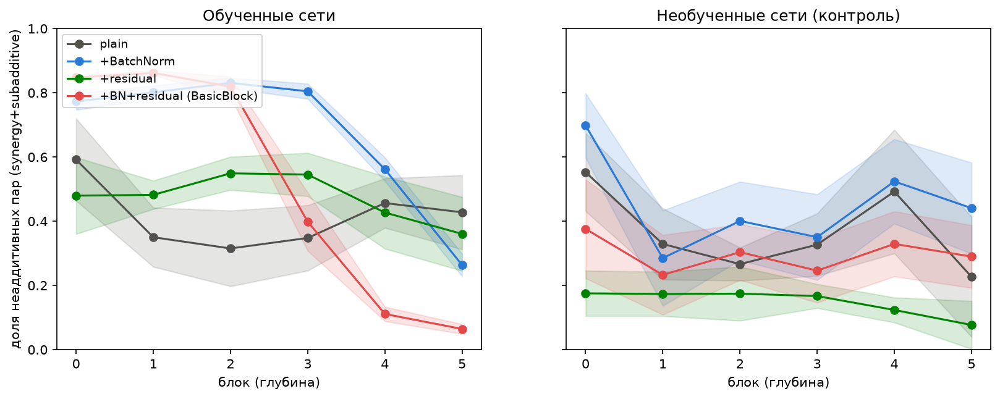
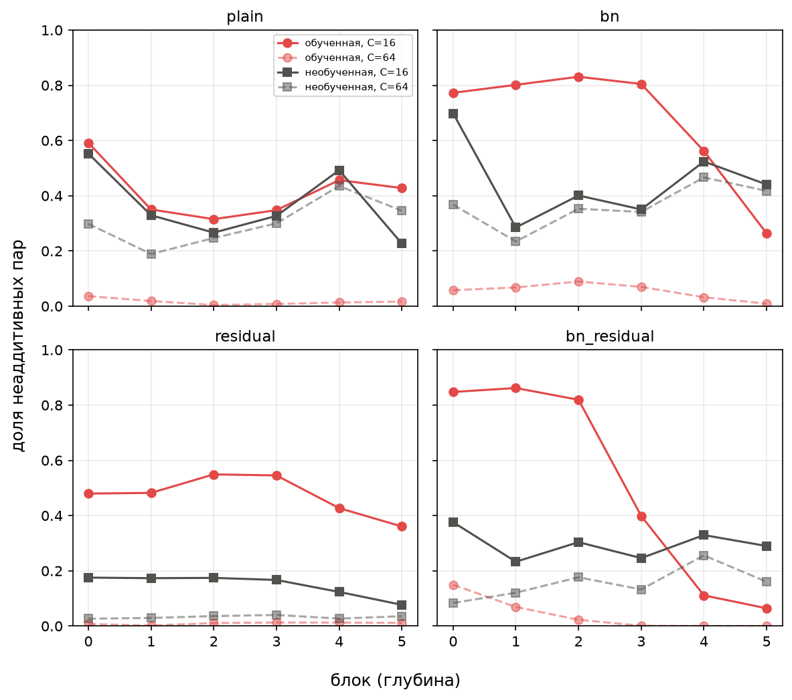
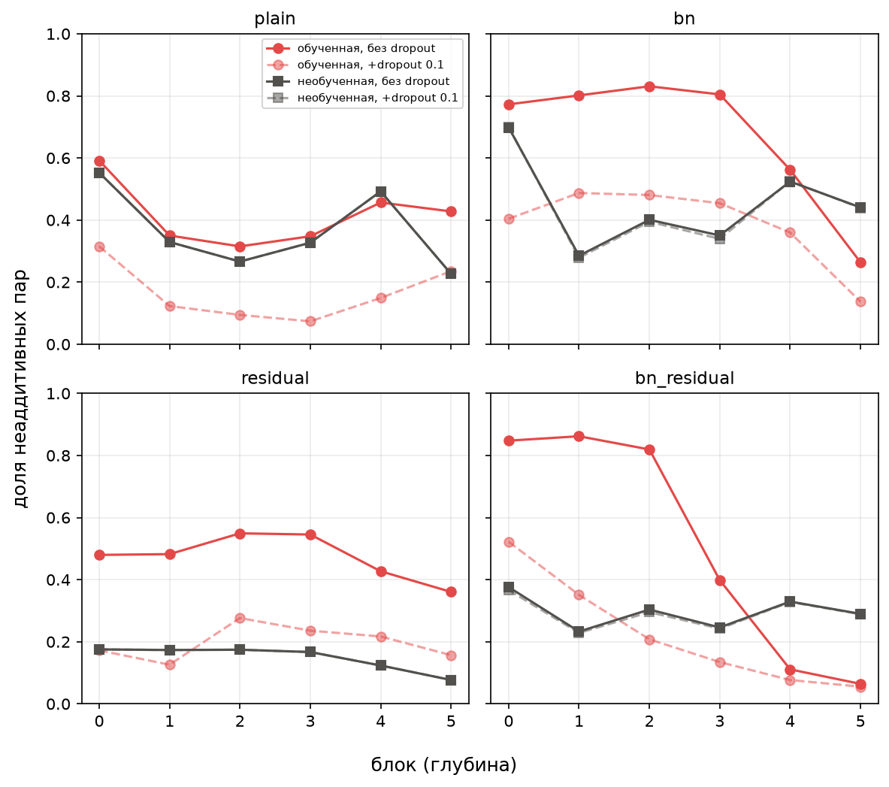

# Профиль по глубине: что из BatchNorm/residual/ширины/dropout гасит попарные связи

## Постановка эксперимента

**Вопрос.** В маленькой сети (conv1+conv2, `synergy_experiments/experiment_common_task.ipynb`) попарные причинные связи между каналами есть. В ResNet-18 — почти нет, на любой проверенной глубине (`synergy_experiments/`, `class_vs_rest_experiments/`). ResNet отличается от маленькой сети сразу в нескольких измерениях — BatchNorm, residual-сложение, ширина слоёв (64-512 вместо 6-64 каналов). Реальная сеть не может разделить эти факторы — нужна управляемая архитектура.

**Архитектура — TapNet.** Conv-стебель + `DEPTH` одинаковых по ширине `C` блоков + avgpool + fc. Каждый блок:

```
x → conv1 → (BatchNorm?) → ReLU → [точка абляции "a"] → conv2 → (BatchNorm?) → (+identity блока?) → ReLU → следующий блок
```

Точка абляции "a" — прямой аналог pre-conv2 хука в `synergy_experiments/resnet_layer_interactions.py`. Сеть строится **один раз** с фиксированной глубиной (`DEPTH=6`) и обучается целиком, одним проходом Adam. Профиль по глубине получается не повторным обучением разных по глубине сетей, а измерением причинного теста **в каждой из 6 точек внутри одной уже обученной сети**.

**Причинный тест** — тот же протокол, что везде в проекте: $S(A,B)=TE(A,B)-TE(A)-TE(B)$ ($S>0$ — синергия), $TE=\text{baseline}-\text{ablated}$, do(zero channel) как интервенция, FDR-BY поправка + порог эффекта $\tau$. Метрика на графиках и во всех таблицах ниже — **доля неаддитивных пар** (|S| выше порога, знак synergy/subadditive здесь не используется и не важен) из всех протестированных, усреднённая по 10 классам MNIST

**4 варианта механизма** — отдельные, независимо обученные с нуля сети (не "включение/выключение" внутри одного прогона):

| механизм | BatchNorm | residual |
|---|:-:|:-:|
| `plain` | — | — |
| `bn` | ✅ | — |
| `residual` | — | ✅ |
| `bn_residual` (= BasicBlock ResNet-18, фикс. ширина, без downsample) | ✅ | ✅ |

Для каждого — 5 обученных (5 эпох, Adam) + 5 необученных (случайная инициализация + калибровка BatchNorm на обычных изображениях, без обучения) сетей, C=16, полный перебор пар (C(16,2)=120).

**Дополнительно** — ширина (C=64, 2+2 сида, 300 случайных пар на блок) и dropout (p=0.1, C=16, 5+5 сидов, полный перебор пар), для всех 4 комбинаций BatchNorm×residual.

## Результат 1 — какой механизм гасит связи с глубиной



| механизм | блок0 | блок1 | блок2 | блок3 | блок4 | блок5 | блок5/блок0 |
|---|---:|---:|---:|---:|---:|---:|---:|
| `plain` | 0.59 | 0.35 | 0.32 | 0.35 | 0.46 | 0.43 | 0.72 |
| `bn` | 0.77 | 0.80 | 0.83 | 0.81 | 0.56 | 0.26 | 0.34 |
| `residual` | 0.48 | 0.48 | 0.55 | 0.55 | 0.43 | 0.36 | 0.75 |
| **`bn_residual`** | 0.85 | 0.86 | 0.82 | **0.40** | **0.11** | **0.06** | **0.08** |

(обученные сети, 5 сидов)

**Сигнал *разный* у всех четырёх, не "постепенное затухание с глубиной" одинаковой формы:**
- `plain` и `residual` (по отдельности) — не затухают, колеблются в диапазоне 0.3–0.6 без системного тренда (сохраняют 72–75% уровня блока 0).
- `bn` (без residual) — держится *высоко* все первые 4 блока (0.77–0.83), падает только в самом конце (блок 4-5). Форма "плато, потом обвал в конце", не постепенное угасание.
- `bn_residual` — единственный с настоящим резким коллапсом, и он не плавный: плато до блока 2 (0.82), затем обрыв за 2 блока до почти нуля.

**Вывод:** гасит связи не глубина сама по себе и не BatchNorm/residual по отдельности, а их **сочетание** — и то скачком в середине стека, а не монотонным угасанием.

## Результат 2 — ширина



**Обученные сети при C=64:** схлопываются ВСЕ 4 механизма, включая `plain` (ни BN, ни residual) — на C=16 `plain` держал 0.3-0.6 по всей глубине без тренда, на C=64 падает до 0.004-0.037 почти сразу, не хуже `bn_residual`. **Для обученной сети ширина гасит связи сама, архитектура не важна.**

**Необученные сети при C=64:** схлопываются только механизмы с residual-связью (`residual`, `bn_residual`) — `plain_c64`/`bn_c64` держат 0.19-0.47 по всей глубине, как и при C=16, вообще не реагируя на рост ширины. **Для необученной сети решает конкретно residual-связь, не BatchNorm и не ширина сама по себе.**

Предыдущая формулировка ("ширина — решающий фактор, работает даже без обучения") была неполной — без обучения ширина работает только при наличии residual.

## Результат 3 — dropout делает сеть заметно более аддитивной, для всех 4 механизмов



Dropout (p=0.1, channel-wise, после ReLU точки абляции — влияет только на **обучение**: в `.eval()` он identity, поэтому сам причинный тест не меняется, меняется только то, что обучение "впечатывает" в веса). Считается изолированно от механизма и ширины — отдельная фаза `run_experiment.py --dropout-only`, отдельный файл `data/tapnet_dropout_followup.json`; обучению дано на 3 эпохи больше, чем в части 1 (без запаса `plain`+dropout не сходится стабильно, точность падает до случайного уровня).

Доля неаддитивных пар по блокам, ОБУЧЕННЫЕ сети (5 сидов), C=16, без/с dropout 0.1:

| механизм | блок0 | блок1 | блок2 | блок3 | блок4 | блок5 | среднее по глубине | снижение |
|---|---:|---:|---:|---:|---:|---:|---:|---:|
| `plain` | 0.59 | 0.35 | 0.32 | 0.35 | 0.46 | 0.43 | 0.42 | |
| `plain` + dropout | 0.32 | 0.12 | 0.10 | 0.07 | 0.15 | 0.24 | 0.17 | **×2.5** |
| `bn` | 0.77 | 0.80 | 0.83 | 0.81 | 0.56 | 0.26 | 0.67 | |
| `bn` + dropout | 0.40 | 0.49 | 0.48 | 0.45 | 0.36 | 0.14 | 0.39 | **×1.7** |
| `residual` | 0.48 | 0.48 | 0.55 | 0.55 | 0.43 | 0.36 | 0.47 | |
| `residual` + dropout | 0.17 | 0.13 | 0.28 | 0.24 | 0.22 | 0.16 | 0.20 | **×2.4** |
| `bn_residual` | 0.85 | 0.86 | 0.82 | 0.40 | 0.11 | 0.06 | 0.52 | |
| `bn_residual` + dropout | 0.52 | 0.35 | 0.21 | 0.14 | 0.08 | 0.06 | 0.23 | **×2.3** |

**Dropout снижает долю неаддитивных пар во всех 4 механизмах, но не одинаково сильно.** У `plain`, `residual` и `bn_residual` среднее по глубине падает в 2.3–2.5 раза — сопоставимый эффект независимо от того, есть ли уже BatchNorm/residual. У `bn` (BatchNorm без residual) эффект заметно слабее — только в ~1.7 раза: эта комбинация частично "сопротивляется" аддитивизирующему действию dropout и после обучения с ним сохраняет больше неаддитивных связей, чем остальные три варианта на сопоставимом уровне.

На уже-схлопнутых поздних блоках `bn_residual` (4, 5) дропаут почти ничего не меняет — там и без него почти ноль. На необученных сетях числа dropout-версий почти совпадают с версиями без dropout (ожидаемо — dropout не активен без `.train()`).

**Интерпретация.** Dropout при обучении случайно выключает каналы, вынуждая сеть не полагаться на конкретные пары каналов, работающие только вместе — то есть обучает к **взаимозаменяемости** (редундантности), а не к взаимной необходимости (синергии). Если цель — стимулировать синергию ради прунинга (одно из дальнейших направлений), любой такой loss по духу должен быть анти-дропаутом: поощрять каналы, которые работают только в конкретных парах, а не взаимозаменяемость.

## Итог

Нет одного универсального "главного" фактора — он разный для обученных и необученных сетей:
- **Обученная сеть:** решает ширина, независимо от механизма (BatchNorm/residual не нужны).
- **Необученная сеть:** решает наличие residual-связи, независимо от ширины и BatchNorm.
- **Dropout** действует в ту же сторону, что и ширина/обучение — ускоряет гашение связей при любом механизме, но это отдельный, не архитектурный, а обучающий фактор (раздел 3), причём BatchNorm без residual ему частично сопротивляется.

В настоящем ResNet-18 (обученная, широкая, с BN+residual сеть) связи, по-видимому, убиты уже до первой измеримой точки (`layer1`, 64 канала), а не постепенно с глубиной.
